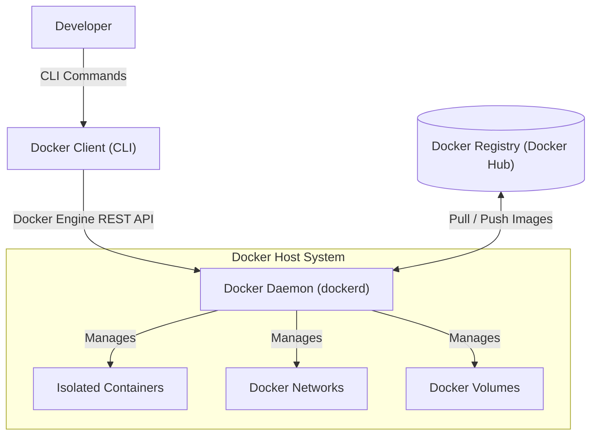
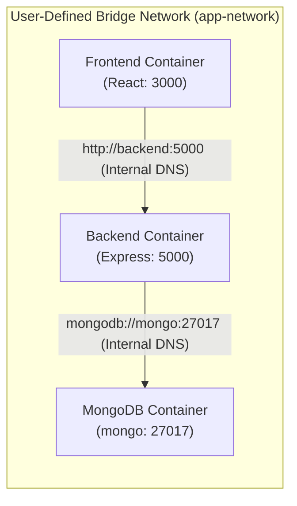
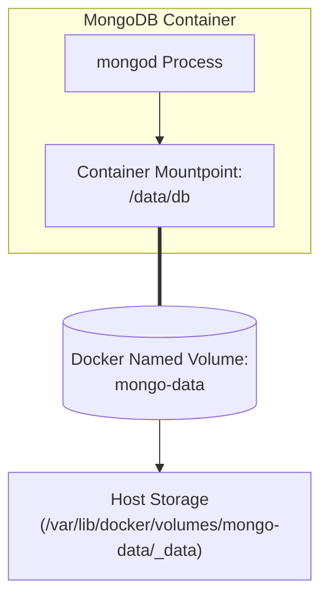
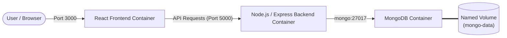

# 🐳 Docker Learning Journey

Welcome to my hands-on Docker learning repository! This project documents my practical journey of mastering Docker through real-world experiments, containerized application setups, and structured interview preparation.

🔗 **Repository:** [https://github.com/labhamsharma1633/docker](https://github.com/labhamsharma1633/docker)

---

## 📌 Learning Progress

- [x] **Docker Fundamentals** (Containerization, Images vs Containers, Architecture)
- [x] **Docker Architecture** (Client, Daemon, Host, Registry, Lifecycle)
- [x] **Docker Networking** (Bridge, Host, DNS resolution, Container communication)
- [x] **Docker Volumes & Persistence** (Anonymous vs Named Volumes, Mounts)
- [x] **MongoDB Containerization** (Port mapping, Anonymous mounts inspection)
- [x] **Named Persistent Storage** (MongoDB with dedicated persistent volume)
- [ ] **Docker Compose** *(Coming Next)*
- [ ] **Dockerfiles & Custom Image Building** *(Coming Next)*
- [ ] **MERN Full-Stack Containerization** *(In Progress)*
- [ ] **Environment Variables & Secrets** *(Coming Next)*
- [ ] **Production-Ready Multi-Stage Builds & Deployment** *(Coming Next)*

---

## 📂 Repository Structure

```text
docker/
│
├── README.md                      # Primary overview, architecture & interview prep
│
├── notes/                         # Deep-dive conceptual & practical notes
│   ├── 01-docker-fundamentals.md   # Core concepts, VMs vs Containers, Image vs Container
│   ├── 02-docker-architecture.md   # Client-server model, daemon, registry, run internals
│   ├── 03-docker-networking.md     # Drivers, custom bridge, embedded DNS, container communication
│   └── 04-docker-volumes.md        # Persistent storage, named volumes, MongoDB walkthrough
│
├── projects/                      # Hands-on containerized applications
│   └── mern-docker-project/       # Multi-tier MERN stack containerization
│
└── commands/                      # Quick reference & cheatsheets
    └── docker-cheatsheet.md       # Categorized Docker CLI commands & flags
```

---

## 1. Docker Fundamentals

### What is Docker?
**Docker** is an open-source platform that enables developers to build, package, ship, and run applications inside isolated environments called **containers**.

### What is Containerization?
Containerization is a form of OS-level virtualization where an application and all its dependencies (binaries, system libraries, configuration files, and runtime) are bundled together into a single lightweight package.

### Why Docker? Solving "It Works on My Machine"
In traditional software delivery, applications frequently fail when moved from a developer's machine to testing or production due to differences in:
- Operating system versions and kernel configurations
- Installed packages, language runtimes, or system library versions
- System path variables and file system layouts

Docker standardizes the runtime environment. The exact container that runs on your local workstation runs identically across staging, QA, and cloud production environments.

### Containers vs. Traditional Virtual Machines

| Feature | Virtual Machines (VMs) | Docker Containers |
| :--- | :--- | :--- |
| **Architecture** | Heavyweight (Hardware virtualization) | Lightweight (OS-level virtualization) |
| **Guest OS** | Includes a full, separate Guest OS | Shares the Host OS kernel |
| **Startup Time** | Minutes (boots full operating system) | Milliseconds to seconds (starts a process) |
| **Resource Usage** | High (reserves fixed RAM and CPU) | Minimal (uses host resources dynamically) |
| **Size** | Gigabytes (GBs) per VM | Megabytes (MBs) per container |
| **Isolation** | Hypervisor-level (hardware level) | Linux namespaces & cgroups (kernel level) |

### Core Advantages of Docker
- **Consistency & Predictability:** Eliminates environment drift across the software delivery lifecycle.
- **Portability:** Write once, run on any machine or cloud provider supporting Docker.
- **High Resource Efficiency:** Multiple containers run on a single host with near-native performance.
- **Rapid Spin-up & Teardown:** Spin up, restart, or destroy instances in seconds.

> [!IMPORTANT]
> **Key Concept:** A stopped container does **NOT** become an image!
> - An **Image** is a read-only template with application binaries and dependencies.
> - A **Container** is a runnable, isolated instance of an image with a thin read-write layer on top.
> - Stopping a container simply halts its processes; its writable layer remains on disk until explicitly removed (`docker rm`). It does not turn into an image unless explicitly committed (`docker commit`).

---

## 2. Docker Architecture

Docker uses a **client-server architecture**:

- **Docker Client (`docker` CLI):** The primary command-line interface developers interact with. It converts user commands (like `docker run`, `docker build`) into REST API requests sent to the Docker Daemon.
- **Docker Host / Docker Daemon (`dockerd`):** A persistent background daemon running on the host system. It listens for Docker API requests and manages Docker objects including images, containers, networks, and volumes.
- **Docker Registry:** A centralized or private repository that stores Docker images (e.g., Docker Hub, AWS ECR, GitHub Container Registry).

### How `docker run nginx` Works Internally
1. **Command Sent:** The developer runs `docker run nginx`. The Docker Client sends a request to the Docker Daemon.
2. **Local Image Lookup:** The Docker Daemon checks the local image store for `nginx:latest`.
3. **Registry Pull (if missing):** If not found locally, the daemon downloads the image layers from Docker Hub.
4. **Container Creation:** The daemon creates an isolated container instance from the image, allocating a writable layer, isolated filesystem, namespaces, and cgroups.
5. **Network Allocation:** The daemon attaches the container to the default bridge network and assigns it a private IP.
6. **Execution:** The daemon executes the default entrypoint/command inside the container.



---

## 3. Docker Networking

Docker networking enables containers to communicate with each other, with the host machine, and with external networks securely and isolation.

### Practical Commands

```bash
# List all existing Docker networks
docker network ls

# Inspect network configuration and connected containers
docker network inspect app-network

# Create a custom user-defined bridge network
docker network create app-network

# Connect an existing container to a network
docker network connect app-network test-container

# Disconnect a container from a network
docker network disconnect app-network test-container

# Remove a network
docker network rm app-network
```

### Docker Network Drivers

| Driver | Description | Common Use Case |
| :--- | :--- | :--- |
| **`bridge`** | Default container network. Provides private internal subnet with NAT for outbound access. | Standalone containers on a single host. |
| **`host`** | Removes network isolation between container and host; shares host's network stack directly. | Maximizing throughput; high-performance workloads. |
| **`none`** | Disables all networking. Only the loopback interface is available. | Isolated batch processing, air-gapped security tasks. |
| **`overlay`** | Connects multiple Docker daemons across different physical hosts. | Swarm / multi-host container orchestration. |

### Container-to-Container Communication & Docker DNS
- **Default Bridge Network:** Containers communicate only via raw IP addresses unless legacy `--link` is used.
- **Custom User-Defined Bridge (`app-network`):** Docker provides an **embedded DNS server** (at `127.0.0.11`) that enables **automatic service discovery by container name**.

#### Practical Example:
If you run:
```bash
docker run -d --name mongo --network app-network mongo
docker run -d --name backend --network app-network my-backend-image
```
The backend can connect to MongoDB using:
```
mongodb://mongo:27017/mydb
```
Docker's internal DNS automatically resolves `mongo` to the private IP assigned to the `mongo` container!

> [!WARNING]
> **What does `localhost` mean inside a container?**
> Inside any container, `localhost` (or `127.0.0.1`) refers strictly to **that specific container's own network namespace**. It does NOT refer to your host computer or another container. Attempting to connect to `localhost:27017` from a backend container will fail because MongoDB is not running inside the backend container.



---

## 4. Docker Volumes & Persistent Storage

### The Problem with Container Storage
Containers use a **Storage Driver** with a copy-on-write (CoW) thin writable layer. 
- Any data written directly to this layer is **ephemeral**: when the container is deleted (`docker rm`), all data written to it is permanently destroyed.
- Writing to this layer has performance overhead due to the copy-on-write mechanism.
- Storing databases or user uploads in the container writable layer is dangerous for production systems.

### What is a Docker Volume?
A **Docker Volume** is a storage mechanism fully managed by Docker on the host filesystem (typically located under `/var/lib/docker/volumes/` on Linux).
- **Independent Lifecycle:** Volumes persist even after the container using them is stopped or removed.
- **Performance:** Bypasses the container storage driver for direct host I/O speed.
- **Sharable:** Can be mounted to multiple containers concurrently.

### Container vs. Volume

| Aspect | Container | Docker Volume |
| :--- | :--- | :--- |
| **Purpose** | Runs application logic & processes | Stores stateful, persistent data |
| **Lifecycle** | Ephemeral (created, stopped, deleted) | Persistent (survives container deletion) |
| **Management** | `docker container` / `docker run` | `docker volume` commands |

### Named vs. Anonymous Volumes
- **Anonymous Volumes:** Created without a custom name (given a long 64-character random hash). Hard to identify and manage; created automatically by images specifying `VOLUME` in their Dockerfile.
- **Named Volumes:** Explicitly named by the user (e.g., `mongo-data`). Easy to reference, inspect, backup, and remount across container lifecycles.

### Volume Commands
```bash
# List all volumes
docker volume ls

# Create a named volume
docker volume create mongo-data

# Inspect volume metadata and mountpoint path
docker volume inspect mongo-data

# Remove a volume (must not be attached to active containers)
docker volume rm mongo-data
```

### Mount Syntax Explained: `-v volume_name:container_path`
```bash
-v mongo-data:/data/db
```
- **`mongo-data`:** The Docker-managed named volume on the host.
- **`:`:** Separator.
- **`/data/db`:** The target directory inside the container where the volume is mounted (MongoDB's default data storage directory).



---

## 5. Practical MongoDB Docker Work

### 1. Launching MongoDB with Port Forwarding
```bash
docker run -d --name mongo -p 27017:27017 mongo
```

#### What happens under the hood?
1. Docker checks for a local `mongo:latest` image. Because it was not found, Docker pulls the image layers from Docker Hub.
2. Starts the container in detached mode (`-d`).
3. Sets container name to `mongo` (`--name mongo`).
4. **Port Mapping (`-p 27017:27017`):** Maps port `27017` on the host to port `27017` inside the container:
   ```
   Host Port: 27017  ── forwarded to ──>  Container Port: 27017
   ```
   This allows applications running directly on the host (like MongoDB Compass or Node.js) to connect to `localhost:27017`.

### 2. Discovering Anonymous Volumes
The official MongoDB `Dockerfile` defines `VOLUME ["/data/db", "/data/configdb"]`. If you do not specify a volume mount, Docker automatically provisions **anonymous volumes**.

We verified this by inspecting the container's mount configurations:
```bash
docker inspect mongo --format "{{json .Mounts}}"
```
Output revealed anonymous volumes mounted to `/data/db` and `/data/configdb` backed by randomized hash directories on the host.

---

## 6. Named MongoDB Volume (Production Approach)

To ensure database files survive container recreations, we transitioned to a **Named Volume**.

### Step 1: Create Dedicated Volume
```bash
docker volume create mongo-data
```

### Step 2: Remove Old Ephemeral Container
```bash
docker stop mongo
docker rm mongo
```

### Step 3: Run MongoDB with Named Volume Mount
```powershell
docker run -d `
  --name mongo `
  -p 27017:27017 `
  -v mongo-data:/data/db `
  mongo
```

### The Separation of Concerns
```
┌───────────────────────────────────────┐
│        Container (Execution)          │  ==> Runs the mongod engine process
└──────────────────┬────────────────────┘
                   │ mounts to /data/db
┌──────────────────▼────────────────────┐
│      Docker Volume (Persistence)      │  ==> Stores BSON data, indices & journals
└───────────────────────────────────────┘
```

### Verification: Proving Data Persistence
1. Insert collections and documents into MongoDB.
2. Stop and delete the container:
   ```bash
   docker stop mongo
   docker rm mongo
   ```
3. Re-run a brand new container mounting the same volume:
   ```bash
   docker run -d --name mongo -p 27017:27017 -v mongo-data:/data/db mongo
   ```
4. **Result:** All collections and records remain intact! 
   - **MongoDB Container:** Destroyed and recreated.
   - **`mongo-data` Volume:** Kept safe on the host.

---

## 7. Practical Project Architecture (In Progress)

I am actively building a **MERN stack containerized project** step-by-step to apply these concepts in a real multi-tier system:



> [!NOTE]
> **Next Milestone:** Unifying this multi-container architecture using **Docker Compose** for single-command orchestration, environment variable management, and automated network bindings.

---

## 8. Docker Interview Quick Revision

<details>
<summary><b>1. What problem does Docker solve?</b></summary>

Docker solves the **"It works on my machine"** problem. It packages code, runtime, system tools, and libraries into a container that runs identically across development, staging, and production environments, eliminating environment mismatch bugs.
</details>

<details>
<summary><b>2. What is containerization?</b></summary>

Containerization is OS-level virtualization where multiple user-space instances (containers) share the host operating system's kernel while running in complete isolation using Linux namespaces and cgroups.
</details>

<details>
<summary><b>3. What is the difference between an Image and a Container?</b></summary>

An **Image** is an immutable, read-only blueprint containing the application and dependencies. A **Container** is an active, runnable instance of an image with a thin read-write layer added on top.
</details>

<details>
<summary><b>4. What are the main components of Docker architecture?</b></summary>

1. **Docker Client:** CLI tool used to execute commands.
2. **Docker Daemon (`dockerd`):** Background service that builds, runs, and manages Docker resources.
3. **Docker Host:** The machine running the daemon.
4. **Docker Registry:** Storage server for images (e.g., Docker Hub).
</details>

<details>
<summary><b>5. What is a Docker network?</b></summary>

A software-defined networking layer that enables communication between containers, host machines, and external endpoints while maintaining network isolation.
</details>

<details>
<summary><b>6. What is the difference between bridge, host, none, and overlay networks?</b></summary>

- **Bridge:** Private internal subnet created on a single host; isolated from host network.
- **Host:** Bypasses container network isolation and attaches directly to host's network stack.
- **None:** Completely isolates container with no network interfaces except loopback.
- **Overlay:** Spans multiple Docker daemon hosts for distributed multi-host cluster communication (e.g., Docker Swarm).
</details>

<details>
<summary><b>7. How do containers communicate with each other?</b></summary>

Containers communicate over a shared Docker network using TCP/IP. On user-defined bridge networks, containers resolve each other by container name via Docker's embedded DNS server.
</details>

<details>
<summary><b>8. Why should container names be used instead of IP addresses?</b></summary>

Container IP addresses are dynamic and change whenever containers are restarted or recreated. Container names remain constant and are resolved automatically by Docker DNS, preventing broken connections.
</details>

<details>
<summary><b>9. What is a Docker Volume and why is it required?</b></summary>

A volume is a Docker-managed directory on the host filesystem that exists outside the container's Union File System. It is required because container writable layers are ephemeral; volumes provide high-performance persistent storage that outlives container lifecycles.
</details>

<details>
<summary><b>10. What is the difference between Named and Anonymous volumes?</b></summary>

- **Named volumes:** Have explicit human-readable names (e.g., `mongo-data`), making them easy to track, reuse, and backup.
- **Anonymous volumes:** Have random 64-character hash names generated by Docker; difficult to reference or reuse once container is removed.
</details>

<details>
<summary><b>11. What does `-v mongo-data:/data/db` mean?</b></summary>

It instructs Docker to mount the host-managed named volume `mongo-data` into the container at path `/data/db`. Any file written to `/data/db` by MongoDB is persisted inside `mongo-data` on the host.
</details>

<details>
<summary><b>12. What happens to volume data when a container is deleted?</b></summary>

The volume data remains completely intact on the host machine. Volumes are independent entities and are only deleted if explicitly removed via `docker volume rm`.
</details>

<details>
<summary><b>13. What does `-p 27017:27017` mean?</b></summary>

It maps port `27017` on the host machine to port `27017` inside the container (`host_port:container_port`), enabling host-level clients to access the service running inside the container.
</details>

<details>
<summary><b>14. What does `localhost` mean inside a container?</b></summary>

Inside a container, `localhost` points strictly to that container's own internal loopback interface. It does **not** refer to the host or other running containers.
</details>

---

## ⚠️ Common Docker Mistakes to Avoid

| # | Common Mistake | Why It Fails | Correct Approach |
| :---: | :--- | :--- | :--- |
| **1** | **Confusing Image and Container** | Expecting an image to run processes directly. | Remember: Image = static blueprint; Container = running process. |
| **2** | **Assuming Stopped Containers Become Images** | Thinking stopping a container creates an image. | Stopping a container keeps its state in its writable layer; use `docker commit` to make an image. |
| **3** | **Using `localhost` to connect to another container** | Each container has its own network namespace; `localhost` is self-referential. | Put containers on the same user-defined bridge network and connect using container names (e.g., `mongo:27017`). |
| **4** | **Hardcoding container IP addresses** | Container internal IPs are dynamic and change on container recreation. | Leverage Docker's embedded DNS by naming containers on a custom bridge network. |
| **5** | **Deleting volumes accidentally** | Running `docker rm -v` or `docker volume prune` can purge stored database data. | Protect critical volumes; back up named volumes before maintenance. |
| **6** | **Confusing named and anonymous volumes** | Letting containers spawn untracked anonymous volumes that clutter disk space. | Explicitly name volumes (`-v my-vol:/path`) for stateful services. |
| **7** | **Forgetting port mapping (`-p`)** | Service is running inside container, but unreachable from host browser/tools. | Expose external access with `-p <host_port>:<container_port>`. |

---

## 🛠️ Docker Commands Cheat Sheet

| Command | Purpose |
| :--- | :--- |
| `docker ps` | List currently running containers |
| `docker ps -a` | List all containers (running and stopped) |
| `docker images` | List all locally cached images |
| `docker run <options> <image>` | Create and start a new container from an image |
| `docker stop <container>` | Gracefully stop a running container |
| `docker rm <container>` | Remove a stopped container |
| `docker inspect <container>` | Display detailed JSON configuration of a container |
| `docker network ls` | List all available Docker networks |
| `docker network create <name>` | Create a user-defined network |
| `docker network inspect <name>` | Inspect network configuration and attached containers |
| `docker volume ls` | List all Docker volumes on the host |
| `docker volume create <name>` | Create a new named volume |
| `docker volume inspect <name>` | Inspect volume details (mountpoint path on host) |
| `docker volume rm <name>` | Remove a specified volume |

---

## 🚀 Learning Approach

$$\text{Learn} \longrightarrow \text{Build} \longrightarrow \text{Break} \longrightarrow \text{Debug} \longrightarrow \text{Document}$$

This repository represents an intentional, hands-on methodology. Rather than passively reading Docker documentation or memorizing commands, every concept is validated through terminal experimentation: creating containers, inspecting their internals, observing failures (such as data loss without volumes or connection timeouts without custom bridge networks), fixing them, and documenting the reasoning.
