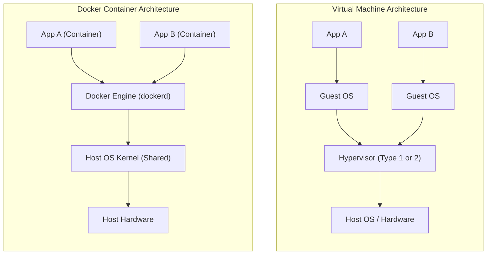

# 01 - Docker Fundamentals & Containerization

Welcome to the foundational notes on Docker. This document explains what Docker is, how containerization works, why it replaces traditional deployment models, and the core distinction between images and containers.

---

## 1. What is Docker?

**Docker** is an open-source platform that enables developers to automate the deployment, scaling, and management of applications by encapsulating them into self-sufficient units called **containers**.

Before Docker, deploying software required configuring the host operating system with specific versions of libraries, runtime environments (e.g., Node.js, Python), and database drivers. Docker bundles the application code alongside every single dependency it needs to run.

---

## 2. What is Containerization?

Containerization is a form of **OS-level virtualization**. Rather than emulating hardware (like traditional virtual machines), containers run on top of the host operating system's kernel, isolating user-space processes from each other.

### How Isolation Works (Under the Hood):
- **Linux Namespaces:** Provide isolation for system resources:
  - `pid` (Process IDs)
  - `net` (Network interfaces and routes)
  - `ipc` (Inter-process communication)
  - `mnt` (Filesystem mount points)
  - `uts` (Hostnames)
- **Control Groups (cgroups):** Allocate and throttle hardware resources (CPU, RAM, disk I/O, network bandwidth).

---

## 3. The "It Works on My Machine" Problem

A classic challenge in software engineering:
> *"The code worked perfectly on my laptop, but threw errors when deployed to staging or production!"*

### Root Causes:
1. **OS and Environment Inconsistencies:** Dev machine running macOS or Windows, production running Debian/Alpine.
2. **Dependency & Runtime Drift:** Dev machine having Node `v20.1` while production had Node `v18.0`.
3. **Missing System Libraries:** Missing OS-level packages (e.g., `libssl`, `imagemagick`).
4. **Configuration Differences:** Different file paths, permissions, and environment variables.

### The Docker Solution:
Docker eliminates this by delivering **identical immutable environments**. If a container runs successfully on a developer's machine, it will run identically on staging, QA, and production clouds.

---

## 4. Containers vs. Traditional Virtual Machines



### Detailed Comparison Table

| Feature | Virtual Machines (VMs) | Docker Containers |
| :--- | :--- | :--- |
| **Virtualization Level** | Hardware level (via Hypervisor) | Operating System level (via OS Kernel) |
| **Operating System** | Each VM includes a complete Guest OS | Shares the Host OS Kernel |
| **Size on Disk** | Heavy (Gigabytes, e.g. 5GB–20GB+) | Lightweight (Megabytes, e.g. 50MB–500MB) |
| **Boot / Start Time** | Minutes (boots kernel, initializes services) | Milliseconds to Seconds (starts a process) |
| **Resource Efficiency** | Heavy CPU/RAM overhead per Guest OS | Near-native performance; dynamic RAM/CPU |
| **Isolation Strength** | Strongest (hardware level) | Strong process isolation (namespaces/cgroups) |
| **Portability** | Bulky VM images, difficult to migrate | Portable images, standardized OCI specification |

---

## 5. Core Advantages of Docker

1. **Environment Parity:** What you develop locally is identical to production.
2. **Speed & Agility:** Spin up or tear down containers in fractions of a second.
3. **Microservices Friendly:** Easily break monoliths into isolated services (Frontend, Backend, Database).
4. **Cost & Resource Optimization:** Run significantly more containers on a single host machine compared to VMs.
5. **Simplified Onboarding:** New team members can run `docker run` instead of spending days setting up local databases and runtimes.

---

## 6. Critical Clarification: Images vs Containers

A very common mistake among beginners and an interview favorite:

```
┌─────────────────────────────────┐
│          Docker Image           │  ==> Read-only template / blueprint
└────────────────┬────────────────┘
                 │ docker run (instantiates)
┌────────────────▼────────────────┐
│        Docker Container         │  ==> Live, running process with thin writable layer
└────────────────┬────────────────┘
                 │ docker stop (halts process)
┌────────────────▼────────────────┐
│        Stopped Container        │  ==> Suspended process state (NOT an image!)
└─────────────────────────────────┘
```

> [!IMPORTANT]
> **Does a stopped container become an image?**
> **NO.** 
> - A stopped container is simply a container whose processes have exited.
> - Its state and thin writable layer still exist on the host filesystem.
> - It does NOT convert into an image automatically.
> - To create an image from a container, you must explicitly run `docker commit <container_id> <new_image_name>`, although building via a `Dockerfile` is the standard best practice.

---

## 7. Interview Revision Questions

1. **What is the difference between an image and a container?**
   - An *Image* is an immutable, read-only package containing application binaries, libraries, and runtime instructions.
   - A *Container* is an isolated, executable runtime instance of an image with a thin read-write layer added on top.

2. **Why are Docker containers lighter than virtual machines?**
   - Containers do not package a guest operating system; they share the host system's kernel and utilize Linux kernel primitives (`namespaces` and `cgroups`) for process isolation.

3. **What is the "It works on my machine" problem and how does Docker fix it?**
   - It occurs when an app runs on a developer's machine but fails elsewhere due to differing dependencies, OS configs, and library versions. Docker bundles the entire execution environment into a container image, guaranteeing consistent execution everywhere.
