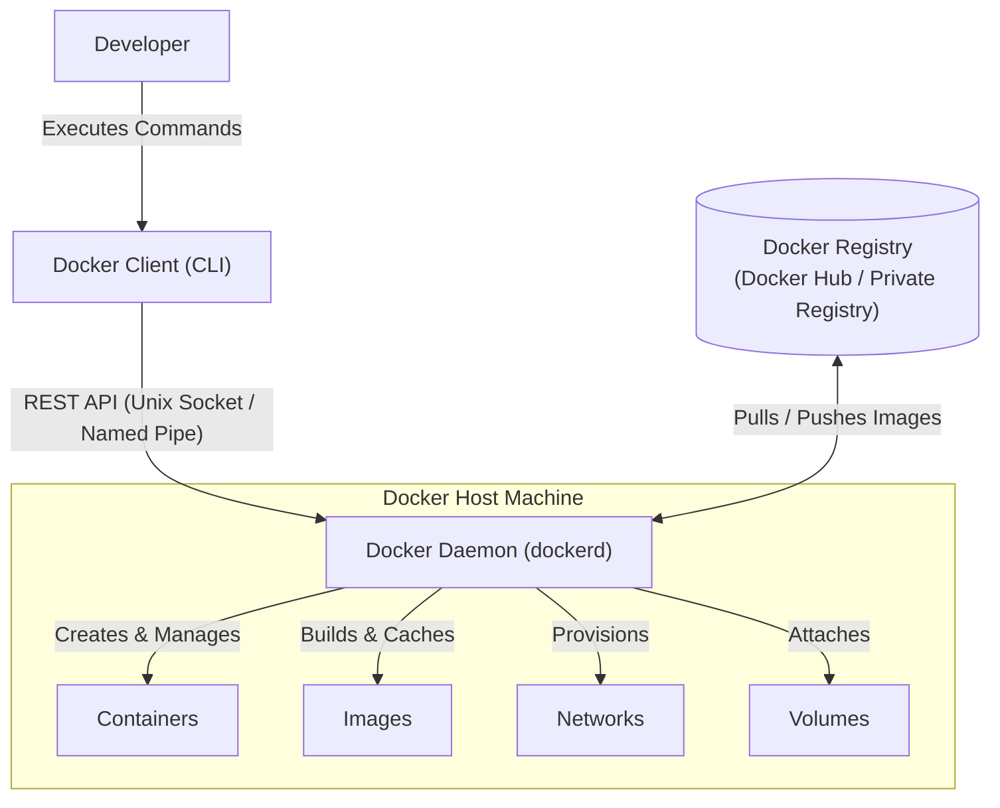
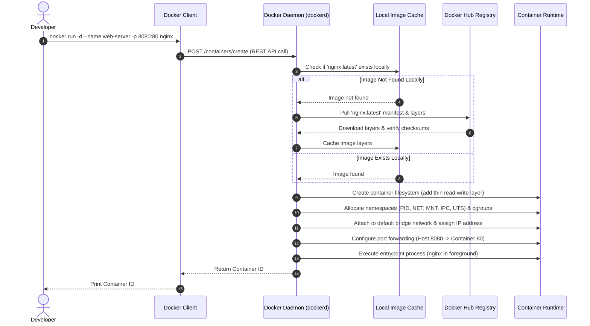

# 02 - Docker Architecture & Internal Mechanics

Understanding Docker's internal architecture is critical for debugging containers, network connectivity, and answering systems-level interview questions.

---

## 1. Client-Server Architecture Overview

Docker operates as a **client-server application** consisting of three primary components:

1. **Docker Client (`docker` CLI)**
2. **Docker Host (Docker Daemon / `dockerd`)**
3. **Docker Registry (e.g., Docker Hub)**



---

## 2. Core Architectural Components

### 1. Docker Client
- The user-facing command-line tool (`docker`).
- Accepts commands such as `docker run`, `docker build`, `docker ps`, `docker network create`.
- Does **not** execute containers itself. Instead, it translates commands into HTTP REST API requests and sends them to the Docker Daemon.
- Can connect to a local Docker daemon (via Unix domain socket `/var/run/docker.sock` on Linux or named pipes on Windows) or a remote daemon over TCP/TLS.

### 2. Docker Host & Docker Daemon (`dockerd`)
- The long-running background engine running on the host system.
- Listens for Docker REST API requests.
- Responsible for:
  - Building images (`docker build`)
  - Running and managing container lifecycles (`docker run`, `docker stop`, `docker rm`)
  - Managing network interfaces, IP assignment, and DNS
  - Allocating storage drivers and persistent volumes
  - Communicating with container runtimes (`containerd` and `runc`).

### 3. Docker Registry
- A centralized or private repository that catalogs and stores Docker images.
- **Docker Hub** (`hub.docker.com`) is the public default registry.
- Organizations often use private registries like AWS ECR, Google Artifact Registry, Azure Container Registry, or self-hosted Harbor.

---

## 3. Deep Dive: What Happens During `docker run nginx`?

When you execute:
```bash
docker run -d --name web-server -p 8080:80 nginx
```

Here is the exact step-by-step sequence executed under the hood:



---

## 4. Key Takeaways & Interview Revision

1. **Does the Docker CLI directly start containers?**
   - No. The Docker CLI is merely a REST client. It delegates all operational tasks to the Docker Daemon (`dockerd`), which in turn interacts with low-level runtimes (`containerd` and `runc`).

2. **Where does Docker store images and volumes on Linux?**
   - Typically in `/var/lib/docker/` (under directories such as `overlay2/` for storage layers and `volumes/` for named volumes).

3. **What is the role of `containerd` and `runc` in modern Docker architecture?**
   - `dockerd` handles API, network, and storage orchestration.
   - `containerd` manages the container lifecycle (image transfer, execution, supervision).
   - `runc` is the OCI-compliant runtime that directly configures Linux namespaces and cgroups to spawn the actual container process.
