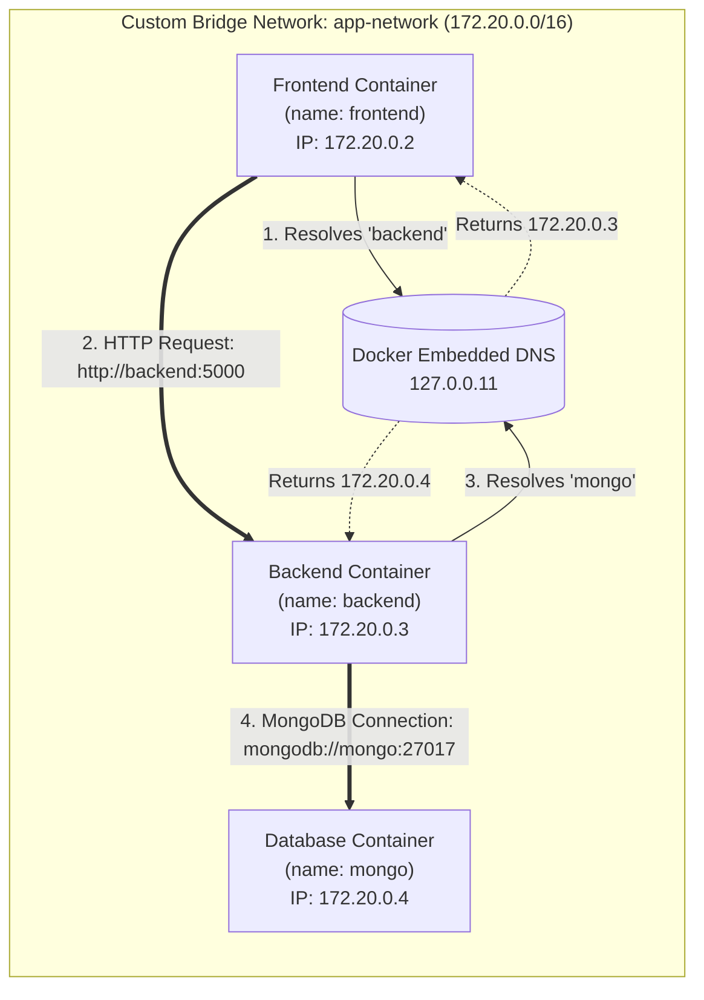

# 03 - Docker Networking & Inter-Container Communication

Networking is how containers communicate with one another, with the host machine, and with external APIs across the Internet.

---

## 1. Practical Network Commands Learned

```bash
# List all active Docker networks
docker network ls

# Inspect a network's configuration, subnet, gateway, and attached containers
docker network inspect app-network

# Create a custom user-defined bridge network
docker network create app-network

# Connect a running container to a network
docker network connect app-network test-container

# Disconnect a container from a network
docker network disconnect app-network test-container

# Remove a user-defined network (must have no active containers attached)
docker network rm app-network
```

---

## 2. Docker Network Drivers Explained

| Driver | How It Works | Isolation Level | When to Use |
| :--- | :--- | :--- | :--- |
| **`bridge`** *(Default)* | Creates an internal software bridge on the host (like a private router). Assigns private subnet IPs with NAT. | High (isolated private subnet) | Standard multi-container apps on a single machine. |
| **`host`** | Bypasses network isolation. Container shares the host's network stack directly (no port mapping needed). | Low (shares host ports) | High-performance networking; apps with massive throughput requirements. |
| **`none`** | Disables network stack entirely. Only the loopback interface (`127.0.0.1`) exists inside the container. | Total isolation | Secure computations, isolated batch algorithms, sensitive workloads. |
| **`overlay`** | Creates a distributed network layer across multiple physical Docker hosts. | High across hosts | Multi-host clusters, Docker Swarm, and distributed microservices. |

---

## 3. Default Bridge vs. Custom User-Defined Bridge

This is one of the most important concepts in Docker:

| Feature | Default Bridge (`bridge`) | Custom Bridge (`docker network create ...`) |
| :--- | :--- | :--- |
| **Automatic DNS Resolution** | ❌ **No**. Containers can only communicate via raw IP addresses (unless using deprecated `--link`). | ✅ **Yes**. Containers resolve each other automatically using **Container Names**. |
| **Isolation** | All unassigned containers share this network, increasing collision risks. | Isolated scope; only explicitly connected containers can talk to each other. |
| **Dynamic Configuration** | Cannot attach/detach containers to default bridge on the fly cleanly. | Containers can be connected or disconnected dynamically without restarting. |

---

## 4. Container-to-Container Communication & Docker DNS

When you create a user-defined bridge network:
```bash
docker network create app-network
```
Docker starts an **internal DNS service** at IP `127.0.0.11` inside the network namespace.



### The Database Connection Example:
Inside the backend code:
```javascript
// ✅ Correct on user-defined bridge network:
const MONGO_URI = "mongodb://mongo:27017/shopdb";

// ❌ Incorrect: Hardcoded IP will fail if container is restarted and assigned a new IP:
// const MONGO_URI = "mongodb://172.20.0.4:27017/shopdb";
```

---

## 5. Why `localhost` Does NOT Work Between Containers

> [!WARNING]
> **The `localhost` Misconception:**
> Many developers configure their backend to connect to `mongodb://localhost:27017`.
> 
> **Why this fails:**
> Inside a container, `localhost` (or `127.0.0.1`) refers **strictly to that container's own isolated loopback interface**.
> - Inside the `backend` container, `localhost:27017` means: *"Find MongoDB running inside the backend container."*
> - Since MongoDB is running in a separate container, the connection is immediately rejected!
> - **Solution:** Connect using the container name on a shared user-defined network: `mongodb://mongo:27017`.

---

## 6. Interview Quick Review

1. **How do containers communicate on the same user-defined network?**
   - They use Docker's embedded DNS server (`127.0.0.11`) to resolve container names to their private network IPs.

2. **Why shouldn't you hardcode container IP addresses in application configs?**
   - Container IPs are ephemeral and change whenever a container restarts or is recreated. Container names remain static and reliable.

3. **What is the difference between host networking and bridge networking?**
   - Bridge networking isolates the container behind a private virtual network requiring port publishing (`-p`). Host networking attaches the container directly to the host's network interfaces, removing network isolation and overhead.
