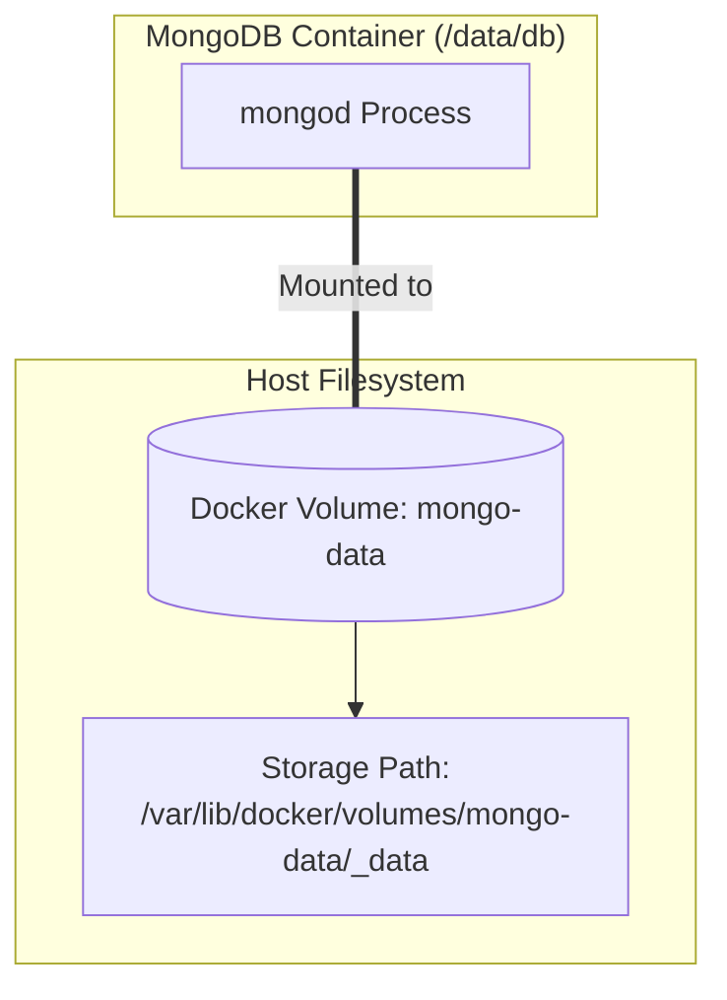

# 04 - Docker Volumes & Persistent Storage

This document covers data persistence in Docker, explaining why container storage is ephemeral and how to use Named Volumes for production databases like MongoDB.

---

## 1. The Container Writable Layer Problem

Docker containers use a **Union File System (UFS)** with a copy-on-write (CoW) strategy:
- An image consists of immutable, read-only layers.
- When a container is launched, Docker adds a thin **read-write layer** on top.
- Any file written or modified by the application lives in this temporary layer.

### Why this is dangerous for databases:
1. **Ephemeral Lifecycle:** When you delete a container with `docker rm`, the thin writable layer is deleted along with all database records!
2. **Performance Overhead:** The copy-on-write storage driver introduces I/O latency, making it unsuitable for high-throughput database operations.
3. **Difficult Backups & Migrations:** Data trapped in container layers cannot be easily shared, backed up, or migrated.

---

## 2. What is a Docker Volume?

A **Docker Volume** is a storage directory completely decoupled from the container's Union File System and managed directly by Docker on the host machine.

### Key Characteristics:
- **Independent Lifecycle:** Volumes persist after the container stops or is permanently removed.
- **Direct Host I/O:** Bypasses storage drivers for maximum read/write performance.
- **Easy Backup & Transfer:** Easily backed up, restored, or shared among multiple containers.

```
┌───────────────────────────────────────┐
│     Container Process (MongoDB)       │
└──────────────────┬────────────────────┘
                   │ mounts to /data/db
┌──────────────────▼────────────────────┐
│      Docker Volume (mongo-data)       │
└──────────────────┬────────────────────┘
                   │ stored on host filesystem
┌──────────────────▼────────────────────┐
│  Host Storage (/var/lib/docker/...)   │
└───────────────────────────────────────┘
```

---

## 3. Named vs. Anonymous Volumes

| Feature | Anonymous Volumes | Named Volumes |
| :--- | :--- | :--- |
| **Creation** | Created automatically when an image specifies `VOLUME` or when run with `-v /container/path`. | Explicitly named: `-v mongo-data:/container/path`. |
| **Identification** | 64-character random hash (e.g., `a4f89d0b...`). | Clean human-readable name (e.g., `mongo-data`). |
| **Reusability** | Extremely difficult to remount to a new container. | Simple to reference across new container instances. |
| **Cleanup** | Often left behind as "dangling volumes" cluttering disk space. | Easily tracked and managed via CLI. |

---

## 4. Volume Commands

```bash
# List all existing volumes
docker volume ls

# Create a named volume
docker volume create mongo-data

# Inspect volume details (reveals host mountpoint)
docker volume inspect mongo-data

# Remove a volume (fails if currently in use by an active container)
docker volume rm mongo-data
```

---

## 5. Volume Mount Syntax Explained: `-v`

```bash
-v mongo-data:/data/db
```

- **`mongo-data`:** The name of the Docker-managed volume on the host.
- **`:`:** Syntax separator.
- **`/data/db`:** The target directory inside the container (MongoDB's default data directory).



---

## 6. Practical MongoDB Walkthrough

### Part A: Initial Setup & Anonymous Volumes Discovery
1. We initially launched a standalone MongoDB container:
   ```bash
   docker run -d --name mongo -p 27017:27017 mongo
   ```
2. **Port Forwarding (`-p 27017:27017`):**
   - Host port `27017` is forwarded to container port `27017`.
   - Allows GUI tools (MongoDB Compass) or host applications to connect via `localhost:27017`.
3. **Discovering Default Anonymous Volumes:**
   The official `mongo` image automatically created anonymous volumes for `/data/db` and `/data/configdb`.
   We inspected the mount configurations using:
   ```bash
   docker inspect mongo --format "{{json .Mounts}}"
   ```
   *Result:* Found random hash directories mounted on the host.

---

### Part B: Production Migration to a Named Volume

To ensure data permanence across container recreations:

1. **Create the dedicated named volume:**
   ```bash
   docker volume create mongo-data
   ```

2. **Stop and remove the old ephemeral container:**
   ```bash
   docker stop mongo
   docker rm mongo
   ```

3. **Launch the new container with the named volume mount:**
   ```powershell
   docker run -d `
     --name mongo `
     -p 27017:27017 `
     -v mongo-data:/data/db `
     mongo
   ```

---

## 7. The Core Mental Model & Proof of Persistence

$$\textbf{Container} = \text{Executes the application logic (ephemeral)}$$
$$\textbf{Volume} = \text{Stores the application data (persistent)}$$

### Persistence Test:
1. Connected to MongoDB and inserted sample records.
2. Purposely destroyed the container:
   ```bash
   docker stop mongo
   docker rm mongo
   ```
3. Verified the volume still existed:
   ```bash
   docker volume ls
   ```
4. Re-created the container with the exact same `-v mongo-data:/data/db` mount.
5. **Outcome:** All databases, collections, and records remained completely intact!

---

## 8. Interview Questions & Key Answers

1. **What happens to volume data when a container is deleted?**
   - Nothing. Volumes are independent Docker objects. The volume and all data inside it persist until explicitly deleted with `docker volume rm`.

2. **Why should databases never store data directly inside the container filesystem?**
   - The container writable layer is destroyed when the container is removed (`docker rm`), and the copy-on-write storage driver introduces unnecessary performance overhead.

3. **What is the difference between `-v` (volume mount) and a bind mount?**
   - **Volumes:** Managed completely by Docker inside Docker's dedicated directory tree (`/var/lib/docker/volumes`). Highly portable and secure.
   - **Bind Mounts:** Maps an arbitrary, specific file or directory from the host filesystem (e.g., `-v C:/my-code:/app`). Dependent on host directory structure.
